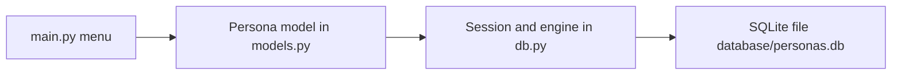

<div align="center">

# SQLite with SQLAlchemy

**A practice project that maps a Python class to a SQLite table with SQLAlchemy and runs the basic ORM queries from a console menu.**

[](LICENSE)


</div>

This is a small learning project for getting started with the SQLAlchemy ORM on top of SQLite. It defines one model (`Persona`, a person), creates the table, inserts a few sample rows and demonstrates the most common query patterns, all driven by a text menu in the terminal. There is no web or graphical interface.

## Table of Contents

- [Overview](#overview)
- [Key Features](#key-features)
- [How It Works](#how-it-works)
- [Data Model](#data-model)
- [Tech Stack](#tech-stack)
- [Project Structure](#project-structure)
- [Getting Started](#getting-started)
- [Usage](#usage)
- [Testing](#testing)
- [Notes](#notes)
- [License](#license)
- [Author](#author)

## Overview

The three Python files follow the layout commonly used for SQLAlchemy examples: one module for the engine and session, one for the models and one for the program that uses them. The code is commented (in Spanish) to explain what the engine, the session and the declarative base are for.

## Key Features

- **Engine, session and declarative base** configured for a SQLite file in `database/personas.db`.
- **ORM model** `Persona` mapped to the table `persona`, with an auto-incrementing primary key.
- **Bulk insert** of six sample people using `session.add_all` followed by a commit.
- **Five query examples**: fetch by primary key, fetch all rows, fetch the first row, count rows and order by a column.
- **Interactive menu** to run the inserts and the queries repeatedly.

## How It Works



On start-up `main.py` drops the existing tables, recreates them from the models, and then loops over a menu until the user chooses to exit.

## Data Model

Table `persona` (class `Persona`):

| Column | Type | Constraints |
|--------|------|-------------|
| `id_persona` | Integer | Primary key, auto-increment |
| `nombre` | String | Not null |
| `edad` | Integer | |
| `apellido` | String | |

## Tech Stack

| Area | Technology |
|------|------------|
| Language | Python 3 |
| ORM | SQLAlchemy (`create_engine`, `sessionmaker`, `declarative_base`) |
| Database | SQLite, through Python's built-in `sqlite3` driver |

## Project Structure

```text
sqlite_with_sqlalchemys/
├── LICENSE
├── README.md
├── db.py              # Engine, session and declarative base
├── models.py          # Persona model
├── main.py            # Console menu, sample data and example queries
└── database/
    └── personas.db    # SQLite file
```

## Getting Started

### Prerequisites

- Python 3 and `pip`
- The `sqlalchemy` package. The repository has no `requirements.txt`; SQLAlchemy is the only third-party package the code imports.

### Installation

```bash
git clone https://github.com/LargoLujan/sqlite_with_sqlalchemys
cd sqlite_with_sqlalchemys
python -m venv .venv
```

Activate the virtual environment:

```bash
# Windows (PowerShell)
.\.venv\Scripts\Activate.ps1

# macOS / Linux
source .venv/bin/activate
```

Install SQLAlchemy:

```bash
pip install sqlalchemy
```

The query example that uses `Query.get` is written for SQLAlchemy 1.4. On SQLAlchemy 2.0 `Query.get` is a legacy API and may emit a deprecation warning; a comment in `main.py` notes that it changed after 1.4.45.

### Configuration

There is no configuration file or environment variable. The database path is the relative string `sqlite:///database/personas.db` in `db.py`, so run the program from the repository root.

### Running

```bash
python main.py
```

## Usage

The program prints this menu and waits for a number:

| Option | Action |
|--------|--------|
| `1` | Add the six sample people to the table |
| `2` | Run the example queries and print the results |
| `8` | Exit |

The example queries printed by option 2 are: get the row with id 1, list all rows with their fields, get the first row, count the rows and list the rows ordered by name. Run option 1 first so that the table has data; running option 1 twice adds the same people twice.

## Testing

There are no automated tests.

## Notes

- Every run of `main.py` drops and recreates the `persona` table before showing the menu (the code comment says this is meant for testing only), so data from a previous run is not kept.
- The menu reads the option with `int(input(...))`, so entering a non-numeric value ends the program with an error, and the exit option ends the process with exit code 1.

## License

Distributed under the MIT License. See [LICENSE](LICENSE) for details.

## Author

**Manuel Luján Vílchez** — Senior Data Engineer

[](https://github.com/LargoLujan)
[](https://www.linkedin.com/in/manuel-lujan-vilchez)
